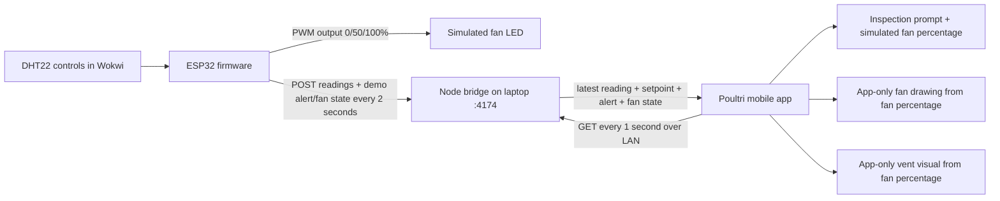
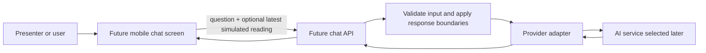

# Poultri Wokwi + Mobile Build Guide

This guide documents the runnable demo defined in [mvp-requirements.md](mvp-requirements.md). The Wokwi project, local bridge, and mobile screen are implemented at the paths below. Follow the stages to install tools, start each part, and connect them; keep every reading labeled simulated.

## What you are building



- **Wokwi:** one simulated ESP32, DHT22, and PWM LED. The firmware uses a demo-only 25°C alert setpoint and 0/50/100% LED levels.
- **Bridge:** one Node.js process using built-in modules only. It keeps the most recent valid sample in memory.
- **Mobile:** an Expo Router House 1 overview and detail screen. The overview shows temperature, humidity, simulated fan percentage, connection/data state, and prompt state. The detail screen includes setpoint, sample age, reference reading, prompt acknowledgement/recovery, app-only fan and vent visuals, local bridge setup, and reset. Shared in-memory session state survives route changes.
- **Network paths:** Wokwi firmware calls `http://host.wokwi.internal:4174`; the phone calls `http://<laptop-LAN-IPv4>:4174`.

This is the **demo architecture**, not the planned farm installation. The concept note's on-site processing and internet-independent monitoring are future capabilities; this Wokwi-to-laptop path does not test them. The 25°C threshold and fan levels are demo choices because the concept note defines no numeric values. The LED is a visual indicator only, not a connected fan.

Wokwi for VS Code 4.0 supplied working networking for this project with no `[net] gateway` override. On 2026-10-18, the Wokwi terminal reported `Bridge POST status: 201`, the local bridge returned the same reading, and the Android emulator displayed it. The simulator UI labeled the connection "Public IoT Gateway"; this observed VS Code behavior should not be generalized to browser-hosted Wokwi, whose public gateway documentation says it cannot reach the local network. The earlier explicit `ws://localhost:9011` override failed and has been removed. [Wokwi Wi-Fi and gateway guide](https://docs.wokwi.com/guides/esp32-wifi), [Wokwi VS Code project configuration](https://docs.wokwi.com/vscode/project-config).

## Prerequisites

1. Windows, VS Code, Git, Node.js LTS, and npm.
2. The VS Code **PlatformIO IDE** extension is the recommended setup; it includes PlatformIO Core and can use its bundled Python, so no separate Python install is needed for this path. If installing standalone PlatformIO Core instead, install Python 3.9+ first and use [PlatformIO's isolated installer](https://docs.platformio.org/en/latest/core/installation/methods/installer-script.html); [its requirements](https://docs.platformio.org/en/latest/core/installation/requirements.html) list supported Python versions.
3. VS Code extensions: **PlatformIO IDE** and **Wokwi for VS Code**. Sign in/activate Wokwi as prompted.
4. An activated Wokwi for VS Code extension.
5. An Android phone and laptop on the same private Wi-Fi for phone testing. The phone must be able to reach the laptop's private IPv4 address.

If Wokwi cannot post to the bridge, finish the sensor-only serial stage and check the Wokwi networking configuration before the connected demo. Do not replace the agreed local architecture with a cloud tunnel or broker.

## Project tree

The files below are present in the repository. `mobile/` includes the two-screen app and a local Expo config plugin for Android's private-LAN HTTP demo setting.

```text
poultri/
├─ bridge/
│  ├─ package.json
│  └─ server.mjs
├─ mobile/
│  ├─ app.json                         # loads the local HTTP config plugin
│  ├─ plugins/with-local-bridge-http.js
│  ├─ src/app/index.tsx                # House 1 overview
│  ├─ src/app/house-1.tsx              # readings, prompt, and bridge setup
│  └─ src/demo-session.tsx             # shared Wokwi bridge session state
└─ wokwi/
   ├─ platformio.ini
   ├─ wokwi.toml
   ├─ diagram.json
   └─ src/
      └─ main.cpp
```

## Stage 1: build and prove the Wokwi sensor project

The Wokwi project files already exist under `wokwi/`; do not create a second PlatformIO project. The simplest setup is to install the **PlatformIO IDE** extension in VS Code, open the `wokwi/` folder, and choose **Project Tasks → esp32dev → General → Build**. PlatformIO IDE includes Core and can use a bundled Python runtime.

For a standalone PlatformIO Core installation instead, install Python 3.9 or newer, then download `get-platformio.py` using the [official isolated installer instructions](https://docs.platformio.org/en/latest/core/installation/methods/installer-script.html) and run:

```powershell
python .\get-platformio.py
```

The installer keeps Core in the user profile and may not add `pio` to `PATH`.

For the standalone Core path on Windows, locate the Core executable from PowerShell and build the existing project:

```powershell
$pio = Join-Path $env:USERPROFILE '.platformio\penv\Scripts\platformio.exe'
& $pio --version
Push-Location .\wokwi
& $pio run
Pop-Location
```

If PlatformIO IDE is providing the CLI on `PATH`, `cd .\wokwi; pio run` is equivalent. The first build downloads the ESP32 platform, compiler, Arduino framework, and DHT library; an internet connection is needed for that initial build. A successful build creates `.pio/build/esp32dev/firmware.bin` and `firmware.elf` for Wokwi.

Open the repository in VS Code. If the extension does not find the nested project automatically, use Command Palette → **Wokwi: Select Config File** and select `wokwi/wokwi.toml`; Wokwi requires selecting a config when it is below the workspace root. Then run Command Palette → **Wokwi: Start Simulator**. The following sections document the checked-in project files for reference. No file copying is needed.

### `wokwi/platformio.ini`

```ini
[env:esp32dev]
platform = espressif32
board = esp32dev
framework = arduino
monitor_speed = 115200
lib_deps =
  beegee-tokyo/DHT sensor library for ESPx
```

Wokwi's DHT22 reference recommends the ESPx DHT library when reading this part from ESP32. Its PlatformIO listing currently marks the library as no longer maintained, so treat it as a Wokwi demo dependency and reassess the library before connecting physical hardware. [DHT22 reference](https://docs.wokwi.com/parts/wokwi-dht22), [PlatformIO library listing](https://registry.platformio.org/libraries/beegee-tokyo/DHT%20sensor%20library%20for%20ESPx).

### `wokwi/diagram.json`

```json
{
  "version": 1,
  "author": "Poultri demo",
  "editor": "wokwi",
  "parts": [
    { "type": "board-esp32-devkit-c-v4", "id": "esp", "top": 0, "left": 0, "attrs": {} },
    { "type": "wokwi-dht22", "id": "dht1", "top": -20, "left": 230, "attrs": { "temperature": "24", "humidity": "60" } },
    { "type": "wokwi-resistor", "id": "r1", "top": 30, "left": 410, "attrs": { "value": "220" } },
    { "type": "wokwi-led", "id": "fanLed", "top": -10, "left": 510, "attrs": { "color": "green", "label": "Sim fan" } }
  ],
  "connections": [
    [ "esp:TX", "$serialMonitor:RX", "", [] ],
    [ "esp:RX", "$serialMonitor:TX", "", [] ],
    [ "esp:3V3", "dht1:VCC", "red", [] ],
    [ "esp:GND.1", "dht1:GND", "black", [] ],
    [ "esp:15", "dht1:SDA", "green", [] ],
    [ "esp:18", "r1:1", "green", [] ],
    [ "r1:2", "fanLed:A", "green", [] ],
    [ "fanLed:C", "esp:GND.1", "black", [] ]
  ]
}
```

The DHT22 data pin is GPIO 15; the simulated fan LED is driven on GPIO 18 through a 220Ω resistor. Change the temperature and humidity controls while the simulation is running. The LED shows 0% below 25°C, 50% from 25°C to below 27°C, and 100% at or above 27°C. It is only a visual proxy; no physical fan is controlled. [Wokwi DHT22 controls](https://docs.wokwi.com/parts/wokwi-dht22).

### `wokwi/wokwi.toml`

```toml
[wokwi]
version = 1
firmware = '.pio/build/esp32dev/firmware.bin'
elf = '.pio/build/esp32dev/firmware.elf'
```

Wokwi reads this file next to `platformio.ini`; build the firmware before starting the simulator. With no `[net] gateway` override, Wokwi for VS Code can use its bundled gateway. [PlatformIO project setup](https://docs.wokwi.com/vscode/platformio), [Wokwi project configuration](https://docs.wokwi.com/vscode/project-config).

### `wokwi/src/main.cpp`

```cpp
#include <DHTesp.h>
#include <HTTPClient.h>
#include <WiFi.h>

namespace {
constexpr int DHT_PIN = 15;
constexpr int FAN_LED_PIN = 18;
constexpr float ALERT_SETPOINT_C = 25.0f;
constexpr float FULL_FAN_SETPOINT_C = 27.0f;
constexpr unsigned long SAMPLE_INTERVAL_MS = 2000;
constexpr unsigned long WIFI_RETRY_MS = 5000;
constexpr char BRIDGE_URL[] = "http://host.wokwi.internal:4174/api/reading";

DHTesp dht;
unsigned long lastSampleAt = 0;
unsigned long lastWifiAttemptAt = 0;

void retryWifiWhenDue(unsigned long now) {
  if (WiFi.status() == WL_CONNECTED || now - lastWifiAttemptAt < WIFI_RETRY_MS) {
    return;
  }

  lastWifiAttemptAt = now;
  Serial.println("Wokwi Wi-Fi disconnected; retrying");
  WiFi.begin("Wokwi-GUEST", "", 6);
}

int fanSpeedFor(float temperatureC) {
  if (temperatureC >= FULL_FAN_SETPOINT_C) return 100;
  if (temperatureC >= ALERT_SETPOINT_C) return 50;
  return 0;
}

void postReading(float temperatureC, float humidityPct, bool alertActive, int fanSpeedPct) {
  WiFiClient client;
  HTTPClient http;
  http.setTimeout(1500);

  if (!http.begin(client, BRIDGE_URL)) {
    Serial.println("Bridge URL setup failed");
    return;
  }

  http.addHeader("Content-Type", "application/json");
  String body = "{\"temperatureC\":" + String(temperatureC, 1) +
                ",\"humidityPct\":" + String(humidityPct, 1) +
                ",\"setpointC\":" + String(ALERT_SETPOINT_C, 1) +
                ",\"alertActive\":" + String(alertActive ? "true" : "false") +
                ",\"fanSpeedPct\":" + String(fanSpeedPct) + "}";
  int status = http.POST(body);
  Serial.printf("Bridge POST status: %d\n", status);
  http.end();
}
}  // namespace

void setup() {
  Serial.begin(115200);
  dht.setup(DHT_PIN, DHTesp::DHT22);
  pinMode(FAN_LED_PIN, OUTPUT);
  analogWrite(FAN_LED_PIN, 0);
  WiFi.mode(WIFI_STA);
  WiFi.begin("Wokwi-GUEST", "", 6);
  lastWifiAttemptAt = millis();
  Serial.println("Poultri Wokwi demo starting");
  Serial.println("Demo rule: alert at 25.0 C; simulated fan 0/50/100 percent");
}

void loop() {
  unsigned long now = millis();
  retryWifiWhenDue(now);

  if (now - lastSampleAt < SAMPLE_INTERVAL_MS) {
    delay(20);
    return;
  }
  lastSampleAt = now;

  TempAndHumidity sample = dht.getTempAndHumidity();
  if (isnan(sample.temperature) || isnan(sample.humidity)) {
    Serial.printf("DHT22 read failed: %s\n", dht.getStatusString());
    return;
  }

  const bool alertActive = sample.temperature >= ALERT_SETPOINT_C;
  const int fanSpeedPct = fanSpeedFor(sample.temperature);
  analogWrite(FAN_LED_PIN, fanSpeedPct * 255 / 100);

  Serial.printf("Temperature: %.1f C | Humidity: %.1f %% | Alert: %s | Simulated fan: %d%%\n",
                sample.temperature, sample.humidity, alertActive ? "ACTIVE" : "CLEAR", fanSpeedPct);
  if (WiFi.status() == WL_CONNECTED) {
    postReading(sample.temperature, sample.humidity, alertActive, fanSpeedPct);
  } else {
    Serial.println("Reading not sent; Wi-Fi is disconnected");
  }
}
```

After building, run the simulator from VS Code Command Palette → **Wokwi: Start Simulator**. Use the DHT22 controls to change temperature and humidity and confirm the serial values, alert state, and LED output follow the controls. The firmware reads every two seconds because that matches the DHT22 sampling interval. It continues printing readings if Wi-Fi or the bridge is unavailable. The diagram starts at 24°C. At 25°C the firmware activates the alert and sets the LED to 50%; at 27°C it sets the LED to 100%. The app polls once per second and mirrors the next fresh reading.

To rebuild from the repository root:

```powershell
$pio = Join-Path $env:USERPROFILE '.platformio\penv\Scripts\platformio.exe'
Push-Location .\wokwi
& $pio run
Pop-Location
```

If VS Code is already providing `pio` on `PATH`, use `pio run` instead. If Wokwi still reports a `ws://localhost:9011` error, stop and start the simulation so it reloads the updated `wokwi.toml`. Confirm `Bridge POST status: 201` in the Wokwi terminal.

## Stage 2: run the local Node bridge

The bridge files already exist under `bridge/`. It stores only one reading in memory. It has no database, UI, cloud dependency, authentication, or external npm package. Keep it on a trusted private LAN and do not tunnel it to the public internet.

### `bridge/package.json`

```json
{
  "name": "poultri-local-bridge",
  "version": "0.1.0",
  "private": true,
  "type": "module",
  "scripts": {
    "start": "node server.mjs"
  }
}
```

### `bridge/server.mjs`

```js
import { createServer } from 'node:http';
import { networkInterfaces } from 'node:os';

const PORT = 4174;
const MAX_BODY_BYTES = 1024;
let latestReading = null;

function json(response, status, value) {
  response.writeHead(status, {
    'content-type': 'application/json; charset=utf-8',
    'cache-control': 'no-store',
  });
  response.end(JSON.stringify(value));
}

function readJson(request) {
  return new Promise((resolve, reject) => {
    const chunks = [];
    let size = 0;
    let tooLarge = false;

    request.on('data', (chunk) => {
      size += chunk.length;
      if (size > MAX_BODY_BYTES) {
        tooLarge = true;
        chunks.length = 0;
      } else if (!tooLarge) {
        chunks.push(chunk);
      }
    });

    request.on('end', () => {
      if (tooLarge) {
        reject(Object.assign(new Error('Request body is too large'), { status: 413 }));
        return;
      }
      try {
        resolve(JSON.parse(Buffer.concat(chunks).toString('utf8')));
      } catch {
        reject(Object.assign(new Error('Malformed JSON'), { status: 400 }));
      }
    });
    request.on('error', reject);
  });
}

async function route(request, response) {
  const url = new URL(request.url ?? '/', 'http://localhost');

  if (request.method === 'GET' && url.pathname === '/api/health') {
    json(response, 200, { ok: true });
    return;
  }

  if (request.method === 'GET' && url.pathname === '/api/reading') {
    json(response, 200, { reading: latestReading });
    return;
  }

  if (request.method === 'POST' && url.pathname === '/api/reading') {
    const value = await readJson(request);
    const validTemperature = Number.isFinite(value?.temperatureC) && value.temperatureC >= -40 && value.temperatureC <= 80;
    const validHumidity = Number.isFinite(value?.humidityPct) && value.humidityPct >= 0 && value.humidityPct <= 100;
    const validSetpoint = Number.isFinite(value?.setpointC) && value.setpointC >= -40 && value.setpointC <= 80;
    const validAlert = typeof value?.alertActive === 'boolean';
    const validFanSpeed = Number.isInteger(value?.fanSpeedPct) && value.fanSpeedPct >= 0 && value.fanSpeedPct <= 100;
    if (!validTemperature || !validHumidity || !validSetpoint || !validAlert || !validFanSpeed) {
      json(response, 400, { error: 'Reading fields are invalid or outside the accepted range' });
      return;
    }

    latestReading = {
      temperatureC: value.temperatureC,
      humidityPct: value.humidityPct,
      setpointC: value.setpointC,
      alertActive: value.alertActive,
      fanSpeedPct: value.fanSpeedPct,
      receivedAt: new Date().toISOString(),
    };
    json(response, 201, { ok: true });
    return;
  }

  json(response, 404, { error: 'Not found' });
}

const server = createServer((request, response) => {
  void route(request, response).catch((error) => {
    if (!response.headersSent) {
      json(response, error.status ?? 500, { error: error.message ?? 'Internal error' });
    }
  });
});

server.listen(PORT, '0.0.0.0', () => {
  console.log(`Poultri local bridge listening on port ${PORT}`);
  console.log(`Wokwi URL: http://host.wokwi.internal:${PORT}`);

  const addresses = Object.values(networkInterfaces())
    .flatMap((items) => items ?? [])
    .filter((item) => (item.family === 'IPv4' || item.family === 4) && !item.internal)
    .map((item) => `http://${item.address}:${PORT}`);
  console.log('Candidate phone URLs (choose the laptop address on the same Wi-Fi):');
  for (const address of addresses) console.log(`  ${address}`);
});
```

Run the bridge from the `bridge/` directory:

```powershell
npm.cmd start
```

Allow Node through Windows Firewall on **Private networks only** if prompted. Choose the printed phone URL matching the laptop's Wi-Fi adapter; do not use `host.wokwi.internal` in the phone app. Wokwi uses that special hostname to reach the laptop; Android uses the laptop's LAN IPv4.

### Bridge contract

| Request | Result |
|---|---|
| `GET /api/health` | `200 { "ok": true }` |
| `GET /api/reading` before data | `200 { "reading": null }` |
| `POST /api/reading` | JSON `{ "temperatureC": 24.0, "humidityPct": 60.0, "setpointC": 25.0, "alertActive": false, "fanSpeedPct": 0 }`; success is `201 { "ok": true }` |
| `GET /api/reading` after data | `200 { "reading": { "temperatureC": 24.0, "humidityPct": 60.0, "setpointC": 25.0, "alertActive": false, "fanSpeedPct": 0, "receivedAt": "<ISO-8601>" } }` |
| Bad JSON / invalid values / unknown route | `400` or `413` / `400` / `404` JSON error |

Quick PowerShell checks while the bridge is running:

```powershell
Invoke-RestMethod http://127.0.0.1:4174/api/health
Invoke-RestMethod http://127.0.0.1:4174/api/reading
Invoke-RestMethod -Method Post -Uri http://127.0.0.1:4174/api/reading -ContentType 'application/json' -Body '{"temperatureC":24,"humidityPct":60,"setpointC":25,"alertActive":false,"fanSpeedPct":0}'
Invoke-RestMethod http://127.0.0.1:4174/api/reading
```

The stored sample is in-memory only and disappears when the bridge stops. The bridge accepts DHT22 temperature values from -40°C through 80°C, relative humidity from 0% through 100%, a setpoint from -40°C through 80°C, and a simulated fan percentage from 0 through 100. These are input bounds, not poultry guidance.

## Stage 3: connect the mobile app

The app uses Expo SDK 57, Expo Router, React Native primitives, and the installed safe-area package. The current two-screen flow and shared session are implemented in these modules:

- `mobile/src/app/index.tsx` renders the House 1 overview and links to its detail route.
- `mobile/src/app/house-1.tsx` renders environmental readings, an animated app-only fan drawing and vent visual derived from `fanSpeedPct`, the inspection prompt, and local bridge controls.
- `mobile/src/demo-session.tsx` owns bridge polling and in-memory reading, reference, prompt, acknowledgement, recovery, and reset state. The provider wraps the router in `mobile/src/app/_layout.tsx`, so route changes preserve the active demo session.
- `mobile/src/ui.tsx` contains the shared system light/dark Poultri palette and branded header. The supplied logo and wordmark remain unchanged.

The overview shows temperature, humidity, simulated fan percentage, connection/data status, and prompt status. With no reading, values show a dash and the waiting, stale, or disconnected state remains visible. The detail screen includes the setpoint, sample age, reference reading, acknowledgement and recovery, bridge connection, reset, and a combined simulated-airflow panel for the fan and vent visuals. The fan drawing is still at 0%, spins at 50% or 100%, and stops animating for stale/disconnected data or reduced motion. The vent louvers animate closed at 0%, half-open at 50%, and fully open at 100% using the existing `fanSpeedPct`; there is no added bridge field or control rule. Before a reading both drawings show a dash. Retained values are marked stale or disconnected. The app labels both as app-only simulations: no physical fan, vent, or servo is connected or controlled. Both routes label Wokwi data as simulated.

### Android local HTTP configuration

The bridge is local HTTP for this private-LAN demo. Android 9+ blocks cleartext traffic by default. The existing `mobile/app.json` loads a small local config plugin from `mobile/plugins/with-local-bridge-http.js`:

```json
"plugins": [
  "expo-router",
  "./plugins/with-local-bridge-http"
]
```

The plugin sets `android:usesCleartextTraffic="true"` during native prebuild. This broad HTTP permission is only for the private-LAN prototype. Expo Go is useful for screen iteration but does not rebuild its own native manifest from this project's config; verify with a fresh APK before the phone demo. [Expo SDK 57 app config](https://docs.expo.dev/versions/v57.0.0/config/app/).

The app config blocks unused Android storage, overlay, and vibration permissions. The app only needs Internet access to reach the local bridge; no file, notification, or overlay permission is part of this MVP.

### `mobile/plugins/with-local-bridge-http.js`

```js
const { withAndroidManifest } = require('expo/config-plugins');

module.exports = function withLocalBridgeHttp(config) {
  return withAndroidManifest(config, (configWithManifest) => {
    const application = configWithManifest.modResults.manifest.application?.[0];
    if (application) {
      application.$['android:usesCleartextTraffic'] = 'true';
    }
    return configWithManifest;
  });
};
```

## Stage 4: run each part and connect them

Use three terminals from the repository root, one per process:

```powershell
# Terminal 1
cd .\bridge
npm.cmd start
```

```powershell
# Terminal 2
$pio = Join-Path $env:USERPROFILE '.platformio\penv\Scripts\platformio.exe'
Push-Location .\wokwi
& $pio run
Pop-Location
```

Start the Wokwi simulator in VS Code after the build. If the repository root is open and Wokwi does not find the nested project, use Command Palette → **Wokwi: Select Config File** and choose `wokwi/wokwi.toml`. Click the DHT22, change the temperature and humidity, and confirm the serial values follow the controls. The Wokwi terminal should log `Bridge POST status: 201`. If it cannot post, the sensor simulation can still run by itself, but the mobile app will not receive new readings until networking works.

```powershell
# Terminal 3
cd .\mobile
npm.cmd install
npx.cmd expo start
```

Scan the QR code with Expo Go for UI iteration. Open the House 1 card, enter the laptop's Wi-Fi IPv4 bridge URL on its detail screen, and tap **Connect to bridge**. For a complete alert demo, leave the DHT22 at 24°C while the app connects; raise it to 25°C for an alert and 50% fan indication, then to 27°C for 100%. Lower it below 25°C to show recovery. For acceptance on Android, create a fresh preview APK after changing `app.json`:

```powershell
npx.cmd eas-cli@latest build --platform android --profile preview
```

Install that APK, keep phone and laptop on the same Wi-Fi, and enter the same laptop URL. If Windows Firewall prompts, permit the bridge only on private networks. If the phone cannot connect, check the laptop URL, same-Wi-Fi status, port 4174 firewall allowance, and that Node is still running.

## Demo logic and failure behavior

- On successful Connect, `/api/health` is checked and the app clears the prior session's reading, reference, and prompt.
- The app polls `/api/reading` every second. The first fresh sample is retained as session context; firmware-reported `setpointC`, `alertActive`, and `fanSpeedPct` drive the displayed alert and fan state. The detail fan and vent illustrations follow that same fan percentage without controlling equipment. Humidity is display-only.
- The firmware activates the illustrative prompt at **25°C or higher**. Fan indication is 0% below 25°C, 50% from 25°C to below 27°C, and 100% at or above 27°C. Both values are demo-only and are not poultry guidance.
- One prompt is created on the first active sample. It remains after acknowledgement and after recovery; lowering temperature below 25°C shows recovery.
- Reset clears the local reference and prompt. The sensor value is not changed, so lower it below 25°C or restart Wokwi before a new run.
- Data older than five seconds is stale and cannot create or update a prompt. A request failure changes the connection status to disconnected and preserves the last displayed sample with its age/stale label.
- If Wokwi stops posting, the bridge continues returning the last sample; after five seconds the app marks it stale. If the bridge stops, the app reports disconnected.
- No readings, URL, or prompt are persisted across launches. There are no physical actuators, diagnoses, accounts, cloud services, or physical sensor inputs; the Wokwi LED is a simulated fan indicator only.

## AI chatbot plan (future work, not in this demo)

The current inspection prompt is a deterministic firmware rule; this prototype does not contain a chatbot or send sensor data to an AI service. The supplied concept note does not define an AI chatbot. Keep chat as a separate future idea, outside the two-minute demo, until its product scope and approved content are defined.



### Planned conversation flow

1. The user opens chat from the demo screen and enters a question.
2. The app may attach only the latest reading if the user chooses to include it. Do not send account, farm, flock, location, or persistent history data.
3. A future server-side API validates the message, applies size/time limits, and passes a bounded prompt plus approved reference material to a provider adapter. Keep API credentials on the server; never embed them in the mobile app or Wokwi firmware.
4. The adapter returns a concise answer and any approved reference links. The app labels the answer as AI-generated and offers a retry or clear-chat action.
5. If the question asks for animal diagnosis, medication, safety-critical action, or validated poultry guidance, the assistant declines to advise and directs the user to a qualified poultry professional.

### Implementation sequence when authorized

1. Agree on allowed question types, refusal wording, source material, data retention, provider, and whether the API can be reached during the demo.
2. Write a small approved knowledge pack and example questions before building chat UI.
3. Add a minimal chat screen and typed request/response contract; keep it separate from the sensor alert rule.
4. Add the server-side API and provider adapter only after choosing a provider. Add timeouts, input limits, clear errors, and no message logging by default.
5. Evaluate the allowed questions and refusals, test offline/provider failure behavior, then decide whether chat belongs in the two-minute demo.

## Verification and acceptance

1. **Firmware build:** from `wokwi/`, `pio run` succeeds. The simulator starts and DHT22 slider changes appear in serial output.
2. **Bridge:** check health, empty state, valid POST/GET, malformed JSON rejection, invalid range rejection, and latest-reading replacement. If installed, run `wokwi-cli lint` on `wokwi/diagram.json`.
3. **Mobile static checks:** from `mobile/`, run `npm.cmd run lint` and `npx.cmd tsc --noEmit`. Resolve Expo config with `npx.cmd expo config --type prebuild` and verify the local HTTP plugin loads.
4. **Phone network check:** with the bridge and Wokwi running, Android on the same Wi-Fi sees samples and fan state update after slider changes. Verify 24.9°C = clear/0%/still fan/vent closed, 25.0°C = alert/50%/spinning fan/vent half-open, 27.0°C = alert/100%/faster fan/vent fully open, and below 25°C = recovered/0%/still fan/vent closed. Before the first sample, confirm a dash on both visuals. Stop Wokwi and confirm stale last-known values with stopped fan animation; stop the bridge and confirm disconnected last-known values. Acknowledge, reset the app state, and confirm the next fresh reading becomes the session reference. Check reduced motion, larger text, and dark appearance.
5. **Timed demo:** rehearse the presenter path in [mvp-requirements.md](mvp-requirements.md) with setup complete; it must finish in under two minutes.

Passing lint or type checks is not proof of Android network delivery. Do not describe this prototype as physical sensor integration, the concept note's on-site/offline system, physical fan control, a validated alert rule, or a field-tested product.

## Official references

- [Wokwi DHT22 reference](https://docs.wokwi.com/parts/wokwi-dht22)
- [Wokwi ESP32 Wi-Fi and Private Gateway](https://docs.wokwi.com/guides/esp32-wifi)
- [Wokwi PlatformIO projects](https://docs.wokwi.com/vscode/platformio)
- [Wokwi project configuration](https://docs.wokwi.com/vscode/project-config)
- [Expo SDK 57 app config](https://docs.expo.dev/versions/v57.0.0/config/app/)
- [Expo config plugins](https://docs.expo.dev/config-plugins/plugins/)
