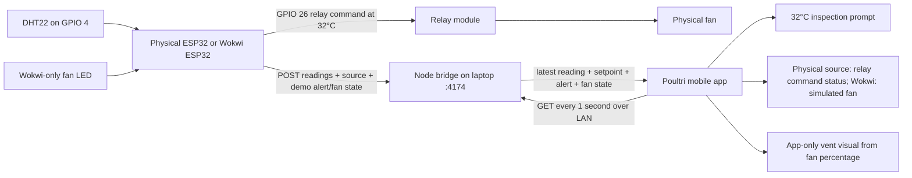
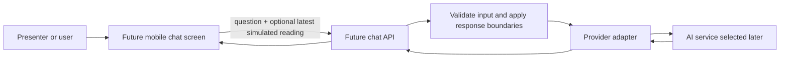

# Poultri Sensor + Mobile Build Guide

This guide documents the runnable demo defined in [mvp-requirements.md](mvp-requirements.md). A physical Arduino IDE ESP32/DHT22 sketch and the Wokwi simulator can both send readings through the same local bridge to the mobile app. The physical ESP32 switches a fan through a relay at the demo 32°C threshold; Wokwi retains its simulated LED fan indicator. These demo rules and physical readings are not farm-validated.

## What you are building



- **Sensor source:** a physical ESP32/DHT22 sketch for Arduino IDE, or the existing simulated ESP32/DHT22/PWM LED in Wokwi. Both post the same reading contract. The physical ESP32 switches a relay on GPIO 26 at 32°C or above and turns it off below 32°C. Only Wokwi has a fan LED.
- **Bridge:** one Node.js process using built-in modules only. It keeps the most recent valid sample in memory.
- **Mobile:** Expo Router Home, History, and Buddy tabs, House 1 detail, and Settings (bridge URL, connection, and confirmed reset). The overview shows temperature, humidity, source-aware fan status, connection/data state, and prompt state. For physical samples the fan status reflects the ESP32 relay command; Wokwi keeps its simulated percentage. The inspection behavior uses the setpoint, but Home and House 1 detail do not display its numeric value or explanatory sentence. House 1 detail includes sample age, reference reading, prompt acknowledgement/recovery, fan/vent visuals, and a compact Bridge setup entry. The vent remains app-only. The separate bridge setup screen contains the local URL, connection controls, and reset. Shared in-memory session state survives route changes.
- **Network paths:** physical ESP32 firmware calls `http://<laptop-LAN-IPv4>:4174/api/reading`; Wokwi calls `http://host.wokwi.internal:4174/api/reading`; the phone calls `http://<laptop-LAN-IPv4>:4174`.

This is the **demo architecture**, not the planned farm installation. The concept note's on-site processing and internet-independent monitoring are future capabilities; this laptop bridge path does not test them. The shared 32°C inspection/fan threshold is a demo choice because the concept note defines no numeric values. The app reports the relay command but has no feedback that verifies fan rotation. Wokwi's LED remains a simulated indicator.

Wokwi for VS Code 4.0 supplied working networking for this project with no `[net] gateway` override. On 2026-10-18, the Wokwi terminal reported `Bridge POST status: 201`, the local bridge returned the same reading, and the Android emulator displayed it. The simulator UI labeled the connection "Public IoT Gateway"; this observed VS Code behavior should not be generalized to browser-hosted Wokwi, whose public gateway documentation says it cannot reach the local network. The earlier explicit `ws://localhost:9011` override failed and has been removed. [Wokwi Wi-Fi and gateway guide](https://docs.wokwi.com/guides/esp32-wifi), [Wokwi VS Code project configuration](https://docs.wokwi.com/vscode/project-config).

## Prerequisites

1. Windows, VS Code, Git, Node.js LTS, and npm for the bridge and app.
2. Arduino IDE 2.x, an ESP32 development board, and a DHT22 for the physical sensor path. Install the Espressif ESP32 board core and Adafruit DHT libraries in Arduino IDE as described below.
3. PlatformIO IDE and Wokwi for VS Code are only needed for the optional simulator path. PlatformIO includes Core and can use bundled Python; no separate Python install is needed for this path.
4. An Android phone and laptop on the same private Wi-Fi for phone testing. The phone and ESP32 must be able to reach the laptop's private IPv4 address.

If the physical ESP32 cannot post to the bridge, confirm its Wi-Fi credentials and laptop URL first. Wokwi remains an alternate local test source. Do not replace this local architecture with a cloud tunnel or broker.

## Project tree

The files below are present in the repository. `mobile/` contains the app and a local Expo config plugin for Android's private-LAN HTTP demo setting.

```text
poultri/
├─ bridge/
│  ├─ package.json
│  ├─ server.mjs
│  └─ serial-forwarder.ps1             # optional USB serial input for a physical ESP32
├─ arduino/
│  └─ PoultriESP32/
│     └─ PoultriESP32.ino              # physical DHT22 + local Wi-Fi bridge sender
├─ mobile/
│  ├─ app.json                         # loads the local HTTP config plugin
│  ├─ plugins/with-local-bridge-http.js
│  ├─ src/app/index.tsx                # House 1 overview
│  ├─ src/app/house-1.tsx              # readings, prompt, and bridge entry
│  ├─ src/app/settings.tsx             # local bridge URL, connection, and confirmed reset
│  ├─ src/app/bridge-setup.tsx         # redirect to Settings for older links
│  └─ src/demo-session.tsx             # shared local sensor bridge session state
└─ wokwi/
   ├─ platformio.ini
   ├─ wokwi.toml
   ├─ diagram.json
   └─ src/
      └─ main.cpp
```

## Stage 1: build and prove the Wokwi sensor project

The Wokwi project files already exist under `wokwi/`; do not create a second PlatformIO project. The simplest setup is to install the **PlatformIO IDE** extension in VS Code, open the `wokwi/` folder, and choose **Project Tasks → esp32dev → General → Build**. PlatformIO IDE includes Core and can use a bundled Python runtime.

For a standalone PlatformIO Core installation instead, install Python 3.9 or newer, then download `get-platformio.py` using the [official isolated installer instructions](https://docs.platformio.org/en/latest/core/installation/methods/installer-script.html) and run:

```powershell
python .\get-platformio.py
```

The installer keeps Core in the user profile and may not add `pio` to `PATH`.

For the standalone Core path on Windows, locate the Core executable from PowerShell and build the existing project:

```powershell
$pio = Join-Path $env:USERPROFILE '.platformio\penv\Scripts\platformio.exe'
& $pio --version
Push-Location .\wokwi
& $pio run
Pop-Location
```

If PlatformIO IDE is providing the CLI on `PATH`, `cd .\wokwi; pio run` is equivalent. The first build downloads the ESP32 platform, compiler, Arduino framework, and DHT library; an internet connection is needed for that initial build. A successful build creates `.pio/build/esp32dev/firmware.bin` and `firmware.elf` for Wokwi.

Open the repository in VS Code. If the extension does not find the nested project automatically, use Command Palette → **Wokwi: Select Config File** and select `wokwi/wokwi.toml`; Wokwi requires selecting a config when it is below the workspace root. Then run Command Palette → **Wokwi: Start Simulator**. The following sections document the checked-in project files for reference. No file copying is needed.

### `wokwi/platformio.ini`

```ini
[env:esp32dev]
platform = espressif32
board = esp32dev
framework = arduino
monitor_speed = 115200
lib_deps =
  beegee-tokyo/DHT sensor library for ESPx
```

Wokwi's DHT22 reference recommends the ESPx DHT library when reading this part from ESP32. Its PlatformIO listing currently marks the library as no longer maintained, so treat it as a Wokwi demo dependency and reassess the library before connecting physical hardware. [DHT22 reference](https://docs.wokwi.com/parts/wokwi-dht22), [PlatformIO library listing](https://registry.platformio.org/libraries/beegee-tokyo/DHT%20sensor%20library%20for%20ESPx).

### `wokwi/diagram.json`

```json
{
  "version": 1,
  "author": "Poultri demo",
  "editor": "wokwi",
  "parts": [
    { "type": "board-esp32-devkit-c-v4", "id": "esp", "top": 0, "left": 0, "attrs": {} },
    { "type": "wokwi-dht22", "id": "dht1", "top": -20, "left": 230, "attrs": { "temperature": "24", "humidity": "60" } },
    { "type": "wokwi-resistor", "id": "r1", "top": 30, "left": 410, "attrs": { "value": "220" } },
    { "type": "wokwi-led", "id": "fanLed", "top": -10, "left": 510, "attrs": { "color": "green", "label": "Sim fan" } }
  ],
  "connections": [
    [ "esp:TX", "$serialMonitor:RX", "", [] ],
    [ "esp:RX", "$serialMonitor:TX", "", [] ],
    [ "esp:3V3", "dht1:VCC", "red", [] ],
    [ "esp:GND.1", "dht1:GND", "black", [] ],
    [ "esp:15", "dht1:SDA", "green", [] ],
    [ "esp:18", "r1:1", "green", [] ],
    [ "r1:2", "fanLed:A", "green", [] ],
    [ "fanLed:C", "esp:GND.1", "black", [] ]
  ]
}
```

The DHT22 data pin is GPIO 15; the simulated fan LED is driven on GPIO 18 through a 220Ω resistor. Change the temperature and humidity controls while the simulation is running. The inspection prompt activates and the LED shows 100% at or above 32°C; both are clear/off below 32°C. The LED is only a visual proxy; no physical fan is controlled. [Wokwi DHT22 controls](https://docs.wokwi.com/parts/wokwi-dht22).

### `wokwi/wokwi.toml`

```toml
[wokwi]
version = 1
firmware = '.pio/build/esp32dev/firmware.bin'
elf = '.pio/build/esp32dev/firmware.elf'
```

Wokwi reads this file next to `platformio.ini`; build the firmware before starting the simulator. With no `[net] gateway` override, Wokwi for VS Code can use its bundled gateway. [PlatformIO project setup](https://docs.wokwi.com/vscode/platformio), [Wokwi project configuration](https://docs.wokwi.com/vscode/project-config).

### `wokwi/src/main.cpp`

```cpp
#include <DHTesp.h>
#include <HTTPClient.h>
#include <WiFi.h>

namespace {
constexpr int DHT_PIN = 15;
constexpr int FAN_LED_PIN = 18;
constexpr float DEMO_THRESHOLD_C = 32.0f;
constexpr unsigned long SAMPLE_INTERVAL_MS = 2000;
constexpr unsigned long WIFI_RETRY_MS = 5000;
constexpr char BRIDGE_URL[] = "http://host.wokwi.internal:4174/api/reading";

DHTesp dht;
unsigned long lastSampleAt = 0;
unsigned long lastWifiAttemptAt = 0;

void retryWifiWhenDue(unsigned long now) {
  if (WiFi.status() == WL_CONNECTED || now - lastWifiAttemptAt < WIFI_RETRY_MS) {
    return;
  }

  lastWifiAttemptAt = now;
  Serial.println("Wokwi Wi-Fi disconnected; retrying");
  WiFi.begin("Wokwi-GUEST", "", 6);
}

int fanSpeedFor(float temperatureC) {
  return temperatureC >= DEMO_THRESHOLD_C ? 100 : 0;
}

void postReading(float temperatureC, float humidityPct, bool alertActive, int fanSpeedPct) {
  WiFiClient client;
  HTTPClient http;
  http.setTimeout(1500);

  if (!http.begin(client, BRIDGE_URL)) {
    Serial.println("Bridge URL setup failed");
    return;
  }

  http.addHeader("Content-Type", "application/json");
  String body = "{\"temperatureC\":" + String(temperatureC, 1) +
                ",\"humidityPct\":" + String(humidityPct, 1) +
                ",\"setpointC\":" + String(DEMO_THRESHOLD_C, 1) +
                ",\"alertActive\":" + String(alertActive ? "true" : "false") +
                ",\"fanSpeedPct\":" + String(fanSpeedPct) + "}";
  int status = http.POST(body);
  Serial.printf("Bridge POST status: %d\n", status);
  http.end();
}
}  // namespace

void setup() {
  Serial.begin(115200);
  dht.setup(DHT_PIN, DHTesp::DHT22);
  pinMode(FAN_LED_PIN, OUTPUT);
  analogWrite(FAN_LED_PIN, 0);
  WiFi.mode(WIFI_STA);
  WiFi.begin("Wokwi-GUEST", "", 6);
  lastWifiAttemptAt = millis();
  Serial.println("Poultri Wokwi demo starting");
  Serial.println("Demo rule: inspection prompt and simulated fan turn ON at 32.0 C or above");
}

void loop() {
  unsigned long now = millis();
  retryWifiWhenDue(now);

  if (now - lastSampleAt < SAMPLE_INTERVAL_MS) {
    delay(20);
    return;
  }
  lastSampleAt = now;

  TempAndHumidity sample = dht.getTempAndHumidity();
  if (isnan(sample.temperature) || isnan(sample.humidity)) {
    Serial.printf("DHT22 read failed: %s\n", dht.getStatusString());
    return;
  }

  const bool alertActive = sample.temperature >= DEMO_THRESHOLD_C;
  const int fanSpeedPct = fanSpeedFor(sample.temperature);
  analogWrite(FAN_LED_PIN, fanSpeedPct * 255 / 100);

  Serial.printf("Temperature: %.1f C | Humidity: %.1f %% | Alert: %s | Simulated fan: %d%%\n",
                sample.temperature, sample.humidity, alertActive ? "ACTIVE" : "CLEAR", fanSpeedPct);
  if (WiFi.status() == WL_CONNECTED) {
    postReading(sample.temperature, sample.humidity, alertActive, fanSpeedPct);
  } else {
    Serial.println("Reading not sent; Wi-Fi is disconnected");
  }
}
```

After building, run the simulator from VS Code Command Palette → **Wokwi: Start Simulator**. Use the DHT22 controls to change temperature and humidity and confirm the serial values, alert state, and LED output follow the controls. The firmware reads every two seconds because that matches the DHT22 sampling interval. It continues printing readings if Wi-Fi or the bridge is unavailable. The diagram starts at 24°C. Below 32°C the prompt is clear and LED is off; at 32°C or above the prompt activates and LED turns on. The app polls once per second and mirrors the next fresh reading.

## Stage 1B: send a physical ESP32/DHT22 reading from Arduino IDE

Use this path instead of starting Wokwi. It needs an ESP32 DevKit, DHT22, relay module, fan, data-capable USB cable, Arduino IDE, and a private 2.4 GHz Wi-Fi network shared with the laptop.

1. In Arduino IDE **File → Preferences**, add Espressif's stable Boards Manager URL: `https://espressif.github.io/arduino-esp32/package_esp32_index.json`.
2. In **Boards Manager**, install **esp32 by Espressif Systems**, then select the board matching the module. A common ESP32-WROOM-32 DevKit uses **ESP32 Dev Module**.
3. In **Library Manager**, install **DHT sensor library by Adafruit** and **Adafruit Unified Sensor**.
4. Connect the DHT22 module: **VCC → 3V3**, **GND → GND**, **DATA → GPIO 4**. A bare four-pin DHT22 needs a pull-up resistor from DATA to 3V3; many breakout modules include one.
5. Connect the relay module's logic input to **GPIO 26**. The sketch defaults to an active-high relay, matching the earlier Arduino sketch; set `RELAY_ACTIVE_LOW` to `true` only if the module is active-low. Connect the fan through a relay rated for its supply and current; never connect the fan directly to an ESP32 GPIO.
6. Copy `arduino/PoultriESP32/secrets.h.example` to `secrets.h` beside the sketch and enter your Wi-Fi name/password there. Set `BRIDGE_URL` in the sketch to the laptop Wi-Fi address printed by the bridge, with `/api/reading` at the end. The local `secrets.h` is ignored by Git.
7. Start the local bridge (Stage 2), then **Verify** and **Upload** the sketch. If upload needs manual bootloader mode, hold **BOOT** while Arduino IDE says “Connecting…”. The Serial Monitor uses **115200 baud**.
8. Confirm temperature/humidity lines and bridge POSTs. The physical fan relay and inspection prompt turn ON at **32.0°C or above** and OFF below **32.0°C**; invalid sensor readings force the relay OFF. If Wi-Fi is not configured, close Serial Monitor and use `bridge/serial-forwarder.ps1 -Port COM7` to forward USB readings to the bridge. The relay still operates locally when Wi-Fi or the bridge is unavailable.

The sketch sends `source: "Local ESP32 + DHT22"` every 2.5 seconds. Physical samples report `fanSpeedPct` as 0 or 100 to mirror the relay command; this is not measured fan speed. Keep the app and laptop on the same Wi-Fi. The app's bridge setup screen takes the base URL such as `http://192.168.1.20:4174` without `/api/reading`.

To rebuild from the repository root:

```powershell
$pio = Join-Path $env:USERPROFILE '.platformio\penv\Scripts\platformio.exe'
Push-Location .\wokwi
& $pio run
Pop-Location
```

If VS Code is already providing `pio` on `PATH`, use `pio run` instead. If Wokwi still reports a `ws://localhost:9011` error, stop and start the simulation so it reloads the updated `wokwi.toml`. Confirm `Bridge POST status: 201` in the Wokwi terminal.

## Stage 2: run the local Node bridge

The bridge files already exist under `bridge/`. It stores only one reading in memory. `serial-forwarder.ps1` is an optional built-in PowerShell path for forwarding USB serial lines from a physical ESP32 when Wi-Fi is not configured. The bridge has no database, UI, cloud dependency, authentication, or external npm package. Keep it on a trusted private LAN and do not tunnel it to the public internet.

### `bridge/package.json`

```json
{
  "name": "poultri-local-bridge",
  "version": "0.1.0",
  "private": true,
  "type": "module",
  "scripts": {
    "start": "node server.mjs"
  }
}
```

### `bridge/server.mjs`

```js
import { createServer } from 'node:http';
import { networkInterfaces } from 'node:os';

const PORT = 4174;
const MAX_BODY_BYTES = 1024;
let latestReading = null;

function json(response, status, value) {
  response.writeHead(status, {
    'content-type': 'application/json; charset=utf-8',
    'cache-control': 'no-store',
    // Web preview runs on another origin; the bridge is local-only, so any origin may read it.
    'access-control-allow-origin': '*',
  });
  response.end(JSON.stringify(value));
}

function readJson(request) {
  return new Promise((resolve, reject) => {
    const chunks = [];
    let size = 0;
    let tooLarge = false;

    request.on('data', (chunk) => {
      size += chunk.length;
      if (size > MAX_BODY_BYTES) {
        tooLarge = true;
        chunks.length = 0;
      } else if (!tooLarge) {
        chunks.push(chunk);
      }
    });

    request.on('end', () => {
      if (tooLarge) {
        reject(Object.assign(new Error('Request body is too large'), { status: 413 }));
        return;
      }
      try {
        resolve(JSON.parse(Buffer.concat(chunks).toString('utf8')));
      } catch {
        reject(Object.assign(new Error('Malformed JSON'), { status: 400 }));
      }
    });
    request.on('error', reject);
  });
}

async function route(request, response) {
  const url = new URL(request.url ?? '/', 'http://localhost');

  if (request.method === 'OPTIONS') {
    response.writeHead(204, {
      'access-control-allow-origin': '*',
      'access-control-allow-methods': 'GET, POST, OPTIONS',
      'access-control-allow-headers': 'content-type',
    });
    response.end();
    return;
  }

  if (request.method === 'GET' && url.pathname === '/api/health') {
    json(response, 200, { ok: true });
    return;
  }

  if (request.method === 'GET' && url.pathname === '/api/reading') {
    json(response, 200, { reading: latestReading });
    return;
  }

  if (request.method === 'POST' && url.pathname === '/api/reading') {
    const value = await readJson(request);
    const source = value?.source ?? 'Wokwi simulated data';
    const validTemperature = Number.isFinite(value?.temperatureC) && value.temperatureC >= -40 && value.temperatureC <= 80;
    const validHumidity = Number.isFinite(value?.humidityPct) && value.humidityPct >= 0 && value.humidityPct <= 100;
    const validSetpoint = Number.isFinite(value?.setpointC) && value.setpointC >= -40 && value.setpointC <= 80;
    const validAlert = typeof value?.alertActive === 'boolean';
    const validFanSpeed = Number.isInteger(value?.fanSpeedPct) && value.fanSpeedPct >= 0 && value.fanSpeedPct <= 100;
    const validSource = source === 'Wokwi simulated data' || source === 'Local ESP32 + DHT22';
    if (!validTemperature || !validHumidity || !validSetpoint || !validAlert || !validFanSpeed || !validSource) {
      json(response, 400, { error: 'Reading fields are invalid or outside the accepted range' });
      return;
    }

    latestReading = {
      source,
      temperatureC: value.temperatureC,
      humidityPct: value.humidityPct,
      setpointC: value.setpointC,
      alertActive: value.alertActive,
      fanSpeedPct: value.fanSpeedPct,
      receivedAt: new Date().toISOString(),
    };
    json(response, 201, { ok: true });
    return;
  }

  json(response, 404, { error: 'Not found' });
}

const server = createServer((request, response) => {
  void route(request, response).catch((error) => {
    if (!response.headersSent) {
      json(response, error.status ?? 500, { error: error.message ?? 'Internal error' });
    }
  });
});

server.listen(PORT, '0.0.0.0', () => {
  console.log(`Poultri local bridge listening on port ${PORT}`);
  console.log(`Physical ESP32 URL pattern: http://<laptop-LAN-IPv4>:${PORT}/api/reading`);
  console.log(`Wokwi URL: http://host.wokwi.internal:${PORT}`);

  const addresses = Object.values(networkInterfaces())
    .flatMap((items) => items ?? [])
    .filter((item) => (item.family === 'IPv4' || item.family === 4) && !item.internal)
    .map((item) => `http://${item.address}:${PORT}`);
  console.log('Candidate phone URLs (choose the laptop address on the same Wi-Fi):');
  for (const address of addresses) console.log(`  ${address}`);
});
```

Run the bridge from the `bridge/` directory:

```powershell
npm.cmd start
```

Allow Node through Windows Firewall on **Private networks only** if prompted. Choose the printed phone URL matching the laptop's Wi-Fi adapter; do not use `host.wokwi.internal` in the phone app. Wokwi uses that special hostname to reach the laptop; Android uses the laptop's LAN IPv4.

### Bridge contract

| Request | Result |
|---|---|
| `GET /api/health` | `200 { "ok": true }` |
| `GET /api/history?hours=N` (1 to 24, default 24) | `200 { "points": [{ "t": <epoch ms>, "temperatureC": 24.0, "source": "live" }] }`; one live point per 10 seconds, kept in memory; `source` is `live` (Wokwi) or `replay` (seed script); `400` for an invalid `hours` |
| `POST /api/history/replay` | JSON `{ "points": [{ "t": <epoch ms>, "temperatureC": 24.0 }] }`, 1 to 1440 points within the last 24 hours; replaces any earlier replay and stores the points as `replay`; `201 { "ok": true, "added": N }`; one invalid point rejects the whole batch with `400` |
| `DELETE /api/history/replay` | Removes replayed points only; `200 { "ok": true, "removed": N }` |
| `GET /api/reading` before data | `200 { "reading": null }` |
| `POST /api/reading` | JSON `{ "source": "Local ESP32 + DHT22", "temperatureC": 24.0, "humidityPct": 60.0, "setpointC": 25.0, "alertActive": false, "fanSpeedPct": 0 }`; success is `201 { "ok": true }`. Legacy Wokwi posts may omit `source` and are labeled `Wokwi simulated data`. |
| `GET /api/reading` after data | `200 { "reading": { "source": "Local ESP32 + DHT22", "temperatureC": 24.0, "humidityPct": 60.0, "setpointC": 25.0, "alertActive": false, "fanSpeedPct": 0, "receivedAt": "<ISO-8601>" } }` |
| Bad JSON / invalid values / unknown route | `400` or `413` / `400` / `404` JSON error |

Quick PowerShell checks while the bridge is running:

```powershell
Invoke-RestMethod http://127.0.0.1:4174/api/health
Invoke-RestMethod http://127.0.0.1:4174/api/reading
Invoke-RestMethod -Method Post -Uri http://127.0.0.1:4174/api/reading -ContentType 'application/json' -Body '{"temperatureC":24,"humidityPct":60,"setpointC":25,"alertActive":false,"fanSpeedPct":0}'
Invoke-RestMethod http://127.0.0.1:4174/api/reading
```

The stored sample is in-memory only and disappears when the bridge stops. The bridge accepts DHT22 temperature values from -40°C through 80°C, relative humidity from 0% through 100%, a setpoint from -40°C through 80°C, and a fan state from 0 through 100. For physical and Wokwi readings, 0/100 mirrors the demo threshold state; these are demo values, not poultry guidance.

## Stage 3: connect the mobile app

The app uses Expo SDK 57, Expo Router, React Native primitives, and the installed safe-area package. The House 1 and bridge flows share session state implemented in these modules:

- `mobile/src/app/index.tsx` renders the House 1 overview and links to its detail route.
- `mobile/src/app/house-1.tsx` renders environmental readings, a fan drawing that follows the physical relay command or simulated Wokwi percentage, an app-only vent visual, the inspection prompt, and a compact link to bridge setup.
- `mobile/src/app/settings.tsx` renders local bridge connection controls and the confirmed session reset (shared `ConnectionSection`); `bridge-setup.tsx` redirects there.
- `mobile/src/demo-session.tsx` owns bridge polling and in-memory reading, reference, prompt, acknowledgement, recovery, and reset state. The provider wraps the router in `mobile/src/app/_layout.tsx`, so route changes preserve the active demo session.
- `mobile/src/ui.tsx` contains the shared system light/dark Poultri palette and branded header. The supplied logo and wordmark remain unchanged.

The overview shows temperature, humidity, source-aware fan status, connection/data status, prompt status, and the source carried by the bridge reading. Physical readings display the ESP32 relay command as ON/OFF; Wokwi displays the simulated fan percentage. The inspection prompt uses the shared 32°C threshold, but Home and House 1 detail do not display its numeric value or setpoint-specific explanation. With no reading, values show a dash and the waiting, stale, or disconnected state remains visible. House 1 detail includes sample age, reference reading, acknowledgement and recovery, a fan/vent panel, and a compact bridge setup entry. For physical and Wokwi readings the fan drawing follows the 0/100% threshold state. The vent remains an app-only visual. Fan animation stops for stale/disconnected data or reduced motion. Before a reading both drawings show a dash. Retained values are marked stale or disconnected. The source badge distinguishes hardware from Wokwi simulation.

### Android local HTTP configuration

The bridge is local HTTP for this private-LAN demo. Android 9+ blocks cleartext traffic by default. The existing `mobile/app.json` loads a small local config plugin from `mobile/plugins/with-local-bridge-http.js`:

```json
"plugins": [
  "expo-router",
  "./plugins/with-local-bridge-http"
]
```

The plugin sets `android:usesCleartextTraffic="true"` during native prebuild. This broad HTTP permission is only for the private-LAN prototype. Expo Go is useful for screen iteration but does not rebuild its own native manifest from this project's config; verify with a fresh APK before the phone demo. [Expo SDK 57 app config](https://docs.expo.dev/versions/v57.0.0/config/app/).

The app config blocks unused Android storage, overlay, and vibration permissions. The app only needs Internet access to reach the local bridge; no file, notification, or overlay permission is part of this MVP.

### `mobile/plugins/with-local-bridge-http.js`

```js
const { withAndroidManifest } = require('expo/config-plugins');

module.exports = function withLocalBridgeHttp(config) {
  return withAndroidManifest(config, (configWithManifest) => {
    const application = configWithManifest.modResults.manifest.application?.[0];
    if (application) {
      application.$['android:usesCleartextTraffic'] = 'true';
    }
    return configWithManifest;
  });
};
```

## Stage 4: run each part and connect them

Use three terminals from the repository root, one per process:

```powershell
# Terminal 1
cd .\bridge
npm.cmd start
```

```powershell
# Terminal 2
$pio = Join-Path $env:USERPROFILE '.platformio\penv\Scripts\platformio.exe'
Push-Location .\wokwi
& $pio run
Pop-Location
```

For the physical Wi-Fi path, upload `arduino/PoultriESP32/PoultriESP32.ino` in Arduino IDE and confirm its Serial Monitor reports `Bridge POST status: 201`. For USB mode, close Serial Monitor and run `bridge/serial-forwarder.ps1 -Port COM7`. For the optional Wokwi path, start the simulator in VS Code, change the DHT22 controls, and confirm the sensor values and POST status. If a source cannot post, the app will not receive fresh readings until its bridge path works.

```powershell
# Terminal 3
cd .\mobile
npm.cmd install
npx.cmd expo start
```

Scan the QR code with Expo Go for UI iteration. Tap the settings button on Home, enter the laptop's Wi-Fi IPv4 bridge URL, and tap **Connect to bridge**. The first fresh sensor reading becomes the app's reference. The inspection prompt, physical relay, and Wokwi fan indicator all use the same 32°C demo threshold. Open **Bridge setup** and tap **Reset session** to finish. For acceptance on Android, create a fresh preview APK after changing `app.json`:

```powershell
npx.cmd eas-cli@latest build --platform android --profile preview
```

Install that APK, keep phone and laptop on the same Wi-Fi, and enter the same laptop URL. If Windows Firewall prompts, permit the bridge only on private networks. If the phone cannot connect, check the laptop URL, same-Wi-Fi status, port 4174 firewall allowance, and that Node is still running.

## Demo logic and failure behavior

- On successful Connect, `/api/health` is checked and the app clears the prior session's reading, reference, and prompt.
- The app polls `/api/reading` every second. The first fresh sample is retained as session context; firmware-reported `setpointC`, `alertActive`, and `fanSpeedPct` drive the alert and fan state. Physical and Wokwi `fanSpeedPct` are 0/100 and follow the shared 32°C threshold. Acknowledgement shows for 60 seconds; at expiry, a fresh below-threshold sample clears the prompt, while an active alert returns to INSPECT. An unacknowledged recovered prompt remains until reset. The app does not send relay commands or verify fan rotation. Humidity is display-only.
- The inspection prompt, physical ESP32 fan relay, and Wokwi simulated fan activate at **32°C or higher** and clear/turn off below 32°C. These are demo-only values and not poultry guidance.
- One prompt is created on the first active sample. Acknowledgement is shown for 60 seconds. If a fresh reading is below 32°C when that interval ends, the acknowledged prompt clears; otherwise an active alert returns to INSPECT. A recovered unacknowledged prompt remains until reset.
- Reset clears the local reference and prompt. It does not change the sensor value; the next fresh reading becomes the reference.
- Data older than five seconds is stale and cannot create or update a prompt. A request failure changes the connection status to disconnected and preserves the last displayed sample with its age/stale label.
- If a sensor source stops posting, the bridge continues returning the last sample; after five seconds the app marks it stale. If the bridge stops, the app reports disconnected.
- No readings, URL, or prompt are persisted across launches. The ESP32 controls only the local fan relay; the app does not control the relay or verify fan rotation. There are no physical vents, diagnoses, accounts, or cloud services. Physical sensor readings are local prototype inputs, not farm-validated data; Wokwi and the app vent remain simulated visuals.

## AI chatbot plan (future work, not in this demo)

The current inspection prompt is a deterministic firmware rule; this prototype does not contain a chatbot or send sensor data to an AI service. The supplied concept note does not define an AI chatbot. Keep chat as a separate future idea, outside the two-minute demo, until its product scope and approved content are defined.



### Planned conversation flow

1. The user opens chat from the demo screen and enters a question.
2. The app may attach only the latest reading if the user chooses to include it. Do not send account, farm, flock, location, or persistent history data.
3. A future server-side API validates the message, applies size/time limits, and passes a bounded prompt plus approved reference material to a provider adapter. Keep API credentials on the server; never embed them in the mobile app or Wokwi firmware.
4. The adapter returns a concise answer and any approved reference links. The app labels the answer as AI-generated and offers a retry or clear-chat action.
5. If the question asks for animal diagnosis, medication, safety-critical action, or validated poultry guidance, the assistant declines to advise and directs the user to a qualified poultry professional.

### Implementation sequence when authorized

1. Agree on allowed question types, refusal wording, source material, data retention, provider, and whether the API can be reached during the demo.
2. Write a small approved knowledge pack and example questions before building chat UI.
3. Add a minimal chat screen and typed request/response contract; keep it separate from the sensor alert rule.
4. Add the server-side API and provider adapter only after choosing a provider. Add timeouts, input limits, clear errors, and no message logging by default.
5. Evaluate the allowed questions and refusals, test offline/provider failure behavior, then decide whether chat belongs in the two-minute demo.

## Verification and acceptance

1. **Firmware build:** from `wokwi/`, `pio run` succeeds. The simulator starts and DHT22 slider changes appear in serial output.
2. **Bridge:** check health, empty state, valid POST/GET, malformed JSON rejection, invalid range rejection, and latest-reading replacement. If installed, run `wokwi-cli lint` on `wokwi/diagram.json`.
3. **Mobile static checks:** from `mobile/`, run `npm.cmd run lint` and `npx.cmd tsc --noEmit`. Resolve Expo config with `npx.cmd expo config --type prebuild` and verify the local HTTP plugin loads.
4. **Phone network check:** with the bridge and Wokwi running, Android on the same Wi-Fi sees samples and the simulated LED state update after slider changes. Verify Wokwi and physical hardware are both 0%/OFF below 32°C and 100%/ON at or above 32°C; the inspection prompt follows the same threshold. Do not infer fan rotation from the physical relay command. Before the first sample, confirm a dash. Stop the source and confirm stale last-known values; stop the bridge and confirm disconnected last-known values. Acknowledge, reset the app state, and confirm the next fresh reading becomes the session reference. Check reduced motion, larger text, and dark appearance.
5. **Timed demo:** rehearse the presenter path in [mvp-requirements.md](mvp-requirements.md) with setup complete; it must finish in under two minutes.

Passing lint or type checks is not proof of Android network delivery. Do not describe this prototype as the concept note's on-site/offline system, a validated alert rule, or a field-tested product. Physical ESP32/DHT22 data and its relay command are local prototype behavior only; the app cannot confirm that the fan is spinning.

## Official references

- [Wokwi DHT22 reference](https://docs.wokwi.com/parts/wokwi-dht22)
- [Wokwi ESP32 Wi-Fi and Private Gateway](https://docs.wokwi.com/guides/esp32-wifi)
- [Wokwi PlatformIO projects](https://docs.wokwi.com/vscode/platformio)
- [Wokwi project configuration](https://docs.wokwi.com/vscode/project-config)
- [Expo SDK 57 app config](https://docs.expo.dev/versions/v57.0.0/config/app/)
- [Expo config plugins](https://docs.expo.dev/config-plugins/plugins/)
