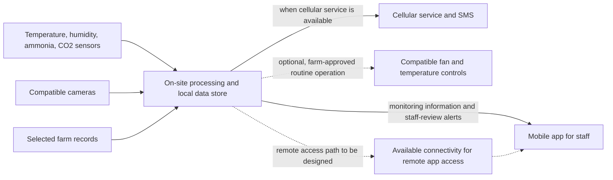

# Poultri MVP and Technical Scope for Patent Refinement

## Document purpose and status

This is a working product and engineering brief derived from the supplied Poultri concept note. It organizes candidate MVPs, mobile-app scope, IoT architecture, data records, validation, and unresolved decisions so the team can refine the technical concept with mentors and a Philippine patent professional.

This is **not** a patent application, a legal opinion, proof of novelty, or evidence that any described feature works. It distinguishes:

- **Concept-note requirement:** expressly described as Poultri's intent or proposed pilot target.
- **Proposed design:** a practical engineering interpretation to evaluate; it is not a commitment in the concept note.
- **To decide:** needs farm assessment, technical experiments, team agreement, or professional advice.

The product is at concept stage. The existing repository demo is a separate Wokwi simulation described in [mvp-requirements.md](mvp-requirements.md) and [build-requirements.md](build-requirements.md). Nothing in this document changes that demo's scope or says that the concept system has been built or tested on a farm.

## 1. Product objective and limits

Poultri is intended to help commercial poultry-farm staff notice changing conditions and prioritize which house to inspect. The proposed system combines environmental readings, camera observations of bird movement, and relevant farm records; processes core monitoring information on-site; presents information in a mobile app; and may send SMS alerts when cellular service is available.

Where site assessment confirms compatibility and the farm approves it, Poultri may support routine operation of fans and temperature controls within farm-approved limits. Poultri flags conditions for staff review. It does not diagnose disease or replace staff judgment.

### Boundaries from the concept note

- Core monitoring is intended to continue during internet interruptions. The proposed target is seven days without internet, assuming local power and required equipment remain available; this has not been demonstrated.
- Remote app access depends on connectivity. The note does not define how remote access is securely routed to an on-site system.
- SMS depends on cellular service. Participating farms are expected to cover SIM and carrier charges.
- The note favors on-site processing and says core processing should not rely on cloud processing or third-party API keys. It does not define whether any non-core cloud storage or relay is allowed.
- Cameras, sensors, records, controls, and installation details depend on site assessments and equipment compatibility.
- Pilot and performance targets are proposed evaluation targets, not established product performance.

## 2. MVP roadmap

Each MVP should answer a specific feasibility question. A later stage should not be treated as complete until its acceptance evidence is recorded. Dates, budget, and sequencing remain to be agreed with the team and pilot farms.

| Stage | Scope | Main question | Evidence to keep |
|---|---|---|---|
| **MVP 0 — Existing simulation demo** | One Wokwi ESP32/DHT22, simulated fan LED, laptop Node bridge, and current mobile screen. Temperature and humidity only; no physical farm equipment. | Can the team demonstrate a simulated reading-to-inspection-prompt workflow? | Firmware/build version, bridge payloads, screen recording, and a clear list of simulated behavior. This is the current repository demo, not a farm MVP. |
| **MVP 1 — Single-house environmental monitoring** | One assessed test house; temperature, humidity, ammonia, and CO₂ sensor inputs; on-site collection and storage; mobile view of readings and connection/data age; staff-review alerts using limits explicitly configured for that test. | Can the proposed equipment collect usable house readings and show them to staff locally? | Sensor make/model and placement, calibration/check procedure, timestamped sample records, alert test cases, and installation notes. No universal poultry threshold is assumed. |
| **MVP 2 — Camera and record context** | Add a compatible camera, a defined bird-movement indicator, and selected farm records relevant to review. Present camera-derived indicators and other information alongside environmental readings for a house. | Does combining these information sources help staff understand why a house was flagged? | Camera input/output definition, observation labels and reference method, selected record fields, reviewed examples, false-alert counts, and staff feedback. Do not assume raw video must leave the farm. |
| **MVP 3 — Local resilience and alerts** | Run core monitoring and event creation on-site during an internet interruption; retain and recover records; add SMS through a cellular service path; define how remote app access works when connectivity is present. | What keeps monitoring available locally, and what happens to queued data and alerts when links fail or return? | Outage/recovery logs, duplicate and missing-record checks, alert timing split into detection/queue/send/receipt, and connectivity/security design. Test the proposed seven-day target only when equipment and power are representative. |
| **MVP 4 — Farm-approved routine controls** | Connect one compatible fan or temperature-control device only after a site safety review; enforce farm-approved operating bounds and staff procedures; provide manual override and safe behavior on sensor, controller, or network failure. | Can an approved routine adjustment be carried out safely and predictably at the assessed site? | Written farm approval, compatibility and hazard review, interlock/fail-safe tests, manual-override tests, command/acknowledgement logs, and incident procedure. Keep this stage disabled until those conditions are met. |
| **Pilot — Integrated evaluation** | Configure suitable MVP capabilities at three prospective commercial layer farms, subject to agreements, assessments, and funding. Proposed live-operation period: 8–12 weeks after installation. | What are performance, compatibility, installation effort, operating cost, and staff-use outcomes in real conditions? | Site-specific configuration, consent and data terms, installation time/cost, alert/inspection/action records, system uptime and outages, false alerts, and farm-baseline comparisons. |

### Proposed pilot measurements from the concept note

Record these as **targets to test**, not claims of current performance:

- Generate an alert within one minute after detection of a pre-defined unusual condition. Record SMS transmission and receipt times separately.
- Assess whether on-site monitoring continues for seven days without internet, while local power and required equipment remain available.
- Aim to detect at least 80% of pre-defined unusual conditions in controlled tests, documenting the reference observations and false alerts.
- Track egg production against each participating farm's available baseline. Treat production change as exploratory; do not claim Poultri caused it.
- Document flagged conditions, staff inspections/actions, and any reported flock or production losses associated with those events.

The team and farms still need to define the conditions, reference labels, test methods, exclusions, and acceptable false-alert rate before evaluating these targets.

## 3. Mobile-app scope

The concept note calls for a companion mobile app through which farm staff can view monitoring information. The following app stages are proposed to support that purpose.

### MVP 1 app

- Show the selected farm/house and the latest available readings for temperature, humidity, ammonia, and CO₂.
- Show when each reading was measured and received, and indicate missing, delayed, or unavailable data so old readings are not mistaken for current readings.
- Show the configured condition/alert, the house that needs review, and a concise reason based on the available monitoring inputs.
- Let staff record that they inspected or acknowledged an alert and capture the action taken, according to the farm's agreed workflow.
- Clearly distinguish current, delayed, and unavailable connectivity. Preserve the concept boundary: the app supports inspection and does not diagnose disease.

### Later app scope

- Add camera-derived bird-movement indicators and selected farm-record context (MVP 2).
- Present local monitoring status during internet interruption, pending/queued events, and restored synchronization status (MVP 3).
- Present a control action only for equipment enabled and approved at that farm; show the requested action and its reported result (MVP 4).
- Provide remote access only after the team defines authentication, authorization, secure transport, and farm data handling. These are design requirements to resolve, not features claimed by the concept note.

### Mobile technology decision

The concept note does not choose a mobile framework. The current demo uses Expo/React Native; Flutter was discussed as a possible alternative. Keep the production framework open until the team confirms mobile/desktop targets, team skills, and required native integrations. A framework choice is not itself the patent contribution.

## 4. Proposed IoT architecture

This logical architecture expresses the concept note without locking suppliers, protocols, or models. Dashed or optional links represent unresolved engineering choices.



### Logical stack and decisions

| Layer | Concept-note scope | Engineering decision still required |
|---|---|---|
| Sensing | Temperature, humidity, ammonia, and CO₂; sensor compatibility assessed at each farm. | Sensor models, ranges, accuracy, calibration, placement, sampling interval, power, wiring, and replacement plan. |
| Camera | Reuse compatible cameras where possible; derive bird-movement observations for staff review. | Camera/stream interface, placement, analysis method, labels/reference data, local processing needs, retention of raw video, and privacy controls. |
| On-site/edge | Core monitoring and routine controls are intended to work without internet/cloud processing. | Edge hardware, local operating software, storage capacity, update/recovery method, timekeeping, and behavior during local power loss. |
| Device connectivity | Sensors, cameras, processing equipment, and controls must connect at each assessed site. | Wired/wireless media and protocols. Assess existing equipment first; do not select a protocol until the actual devices and site are known. |
| Data and rules | Combine sensor readings, camera observations, and farm records; flag conditions for review. | Canonical schema, farm-configured limits, event logic, data-quality handling, versioning, retention, and synchronization rules. |
| Mobile/access | Staff view monitoring information, subject to connectivity for remote access. | Mobile framework, local vs remote access path, identity and permissions, secure transport, accessibility, and supported phones. |
| SMS | Send alerts when cellular service is available. | Cellular modem/SIM or approved service provider, retry/receipt behavior, cost, message format, and escalation procedure. |
| Controls | Operate compatible fans/temperature controls only within farm-approved limits. | Supported equipment, command interface, authorization, local interlocks, manual override, fail-safe state, and audit log. |

### Proposed design principles to validate

- Keep core event detection, local records, and any enabled routine control at the farm site; internet loss must not silently stop these functions.
- Treat each sensor/camera/control integration as an adapter to a documented internal interface so equipment can be assessed and replaced independently.
- Store both the measurement time and the on-site receipt time. Detect missing/stale readings and preserve event order through outages.
- Make condition limits farm-specific and explicitly configured. The concept note defines no numeric threshold or universal control rule.
- Keep control disabled by default until equipment compatibility, farm approval, operating limits, and fail-safe behavior are documented.
- Define remote access and synchronization without introducing cloud processing of core monitoring or third-party API keys contrary to the concept note.

These are proposed engineering principles, not details already settled in the concept note.

## 5. Draft data schema

The concept note identifies the information to combine but does not define field names, units, identifiers, database, or message format. This initial logical model is a proposal for discussion, not an implementation contract.

| Record | Proposed purpose and fields | Basis/status |
|---|---|---|
| `Farm` | `farm_id`, name/reference, site configuration | Farms and site assessments are in the note; identifiers/config format are proposed. |
| `House` | `house_id`, `farm_id`, label, approved configuration reference | Multiple houses and house-level monitoring are in the note; field structure is proposed. |
| `Device` | `device_id`, `house_id`, kind, make/model, location, status | Sensors, cameras, processing equipment, and controls are in the note; exact inventory is proposed. |
| `Measurement` | `measurement_id`, `house_id`, `device_id`, `type`, `value`, `unit`, `measured_at`, `received_at`, `quality/status` | Environmental measurements are in the note; metadata supports reliable local monitoring and is proposed. |
| `CameraObservation` | `observation_id`, `house_id`, `camera_id`, `indicator`, `observed_at`, `method/version`, optional confidence | Bird movement observations are in the note; indicator vocabulary and confidence handling are to decide. |
| `FarmRecord` | `record_id`, `house_id`, `record_type`, `value/reference`, `period`, `source` | Farm records and egg-production baselines are in the note; record scope and structure are to decide with each farm. |
| `ConditionEvent` | `event_id`, `house_id`, condition, evidence references, detected_at, rule/config version | Conditions are flagged for review in the note; event identity and rule traceability are proposed. |
| `StaffReview` | `review_id`, `event_id`, inspected_at, action/notes, outcome | Staff inspections and actions are pilot measures in the note; fields and user identity policy are to decide. |
| `ControlAction` | `action_id`, `house_id`, equipment, requested action, approved limit/config, requested_at, result/status, override reference | Conditional routine controls are in the note; command and safety fields are proposed and belong only to the control stage. |
| `ConnectivityEvent` | `event_id`, site/device, connection state, occurred_at, queued/synchronized status | Internet interruption/resumption behavior is a proposed pilot target; this record is proposed for evaluating it. |

### Example measurement record (illustrative structure only)

```json
{
  "measurementId": "[assigned identifier]",
  "farmId": "[farm reference]",
  "houseId": "[house reference]",
  "deviceId": "[sensor reference]",
  "type": "temperature",
  "value": "[measured value]",
  "unit": "[configured unit]",
  "measuredAt": "[sensor measurement time]",
  "receivedAt": "[on-site system receipt time]",
  "quality": "[valid, suspect, or unavailable]"
}
```

The identifiers, timestamp fields, quality labels, and JSON format are proposed. The concept note specifies neither a measurement unit nor a particular reading schema. Do not use demo-only 25°C logic as a farm threshold.

## 6. Verification and pilot plan

Before each stage is called an MVP, preserve a repeatable test record. At minimum, document:

1. **Sensor validation:** compare each sensor with an agreed reference; record calibration, placement, missing data, and operating conditions.
2. **Data pipeline:** verify source, unit, timestamps, quality state, house association, duplicate handling, and delayed delivery.
3. **Condition detection:** define each test condition and reference label before measuring detection rate, time to alert, and false alerts.
4. **Offline behavior:** interrupt internet access and confirm local monitoring/event recording; restore access and inspect missing, duplicated, and delayed records. Test the proposed seven-day duration only with representative power and hardware.
5. **Mobile workflow:** staff can identify the house, see current/stale status, review the reason for an alert, and record inspection/action without the app presenting a diagnosis.
6. **SMS:** separately record event detection, send attempt, carrier acceptance, and receipt where measurable; repeat under unavailable cellular service.
7. **Controls:** only after farm approval, test limits, interlocks, manual override, loss of sensor/network/power, and logged action outcomes on the specific compatible equipment.
8. **Pilot operations:** capture installation effort, equipment compatibility, operating costs, staff feedback, and farm-record baselines under agreed data permissions.

No test result should be reported as achieved until evidence from the relevant system and site has been recorded. A simulated demo, a successful software check, and a farm-validated result are different evidence levels.

## 7. Candidate patent investigation (not patent claims)

Potential areas for a patent professional and prior-art search to assess include:

- A particular on-site method for combining environmental readings, camera-derived bird-movement indicators, and selected farm records to identify a house for staff review.
- A particular way to preserve and reconcile house-level monitoring events through internet interruptions while keeping core monitoring on-site.
- A particular safety-constrained method for enabling routine fan/temperature actions only within farm-approved limits, with defined local failure behavior and staff override.

These are search questions, not conclusions that the concepts are new or patentable. A generic combination of known sensors, cameras, apps, SMS, or controls is not by itself evidence of a patentable technical contribution. The team must identify the exact mechanism, alternatives, technical effect, and differences found in prior art.

Before any further public technical disclosure, assemble a dated disclosure history (challenge submissions, pitches, demonstrations, websites, code repositories, and videos), a contributor/inventor record, and relevant team, employment, contest, university, and funding agreements. Ask a Philippine patent professional to assess ownership, prior disclosures, territory, patentability, and filing strategy. This document does not provide legal advice.

## 8. Decisions to resolve with mentors and pilot farms

1. Which exact farm problem and first MVP will be tested, and who will use it?
2. Which sensors, cameras, and controls exist at candidate farms, and what can be reused safely?
3. What unusual conditions will be tested, who defines reference observations, and what false-alert rate is acceptable?
4. What device interfaces, local network, edge hardware, and storage meet site and outage needs?
5. Which farm records are necessary, who may access them, and what consent, retention, and sharing rules apply?
6. How will remote mobile access be secured without moving core monitoring to cloud processing?
7. Which cellular/SMS route is workable at each site, and how will delivery limitations be shown to staff?
8. What approvals, limits, interlocks, manual overrides, and safe states are required before connecting controls?
9. What objective result would justify progressing from each MVP to the next?
10. Which part, if any, appears to be a concrete technical invention after prior-art review?

## 9. Relationship to repository implementation

- [mvp-requirements.md](mvp-requirements.md) remains authoritative for the current Wokwi/mobile demo behavior and acceptance criteria.
- [build-requirements.md](build-requirements.md) remains authoritative for the current demo's architecture, bridge API, and setup.
- [implementation.md](implementation.md) records what this repository actually implements and what has been verified.
- This file is a concept-derived planning brief. The real-camera, real-farm-sensor, offline, SMS, multi-house, production-record, and actuator capabilities above are not implemented by the current demo.
